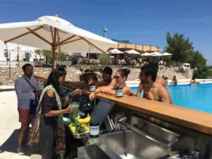

GSD COMMUNITY PARTY CROATIA!

Get ready to blend, shake, and celebrate! Croatia is turning up the tropical vibes as it joins the world in celebrating **Global Smoothie Day (GSD)** with a one-of-a-kind **Community Party** – and everyone’s invited!

Held in the heart of **Zagreb’s vibrant Bundek Park**, the GSD Community Party brought together smoothie lovers, health enthusiasts, families, and local businesses for a full day of fruity fun, community vibes, and eco-conscious celebration.

🍌 **Highlights included**:

-   Live smoothie-making stations featuring local fruits and exotic blends
    
-   DIY smoothie bike blenders (pedal to blend your drink!)
    
-   Workshops on sustainable eating and zero-waste lifestyles
    
-   A kids’ fruit art zone, face painting & smoothie pong
    
-   Live DJ sets, dance sessions, and a massive “Smoothie Toast” at sunset!
    

Local smoothie brands, nutritionists, and wellness influencers also came out in full support, offering free samples, tips, and a whole lot of positive energy. The event was hosted by Croatian wellness ambassador **Mia Zrnić**, who said:

> “It’s more than smoothies – it’s about coming together, celebrating our health, our planet, and each other.”

The GSD Community Party is part of a **global initiative** to promote healthy living, sustainability, and togetherness – one smoothie at a time. From New York to Nairobi, and now Zagreb, communities worldwide are raising their cups and blending up joy.

Missed the event? Don’t worry – the **#GSDEurope** movement is just getting started. Follow @GlobalSmoothieDay on Instagram and TikTok for upcoming events, smoothie recipes, and behind-the-scenes fun.
